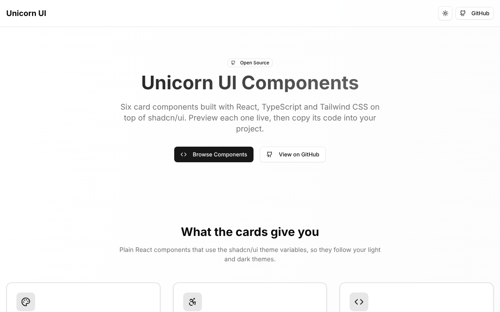
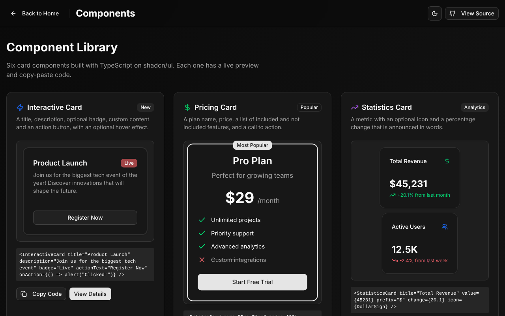
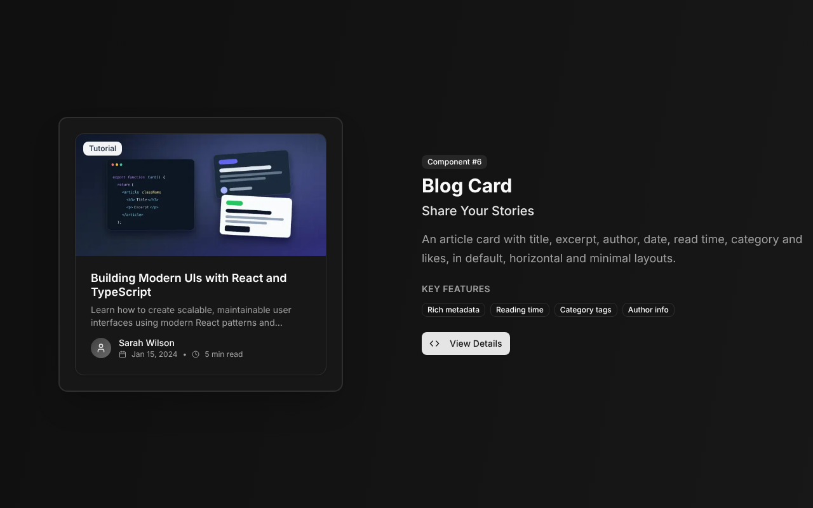

# Unicorn UI

Six copy-paste card components for marketing and SaaS pages, built with React,
TypeScript and Tailwind CSS on top of [shadcn/ui](https://ui.shadcn.com/).

[](https://github.com/tahmidbintaslim/Unicorn-UI/actions/workflows/ci.yml)
[](LICENSE)
[](https://shadcn-ui-library.vercel.app)


**Live demo:** https://shadcn-ui-library.vercel.app

The repo is a Next.js app that shows each card with a live preview and
copy-paste code, and five of the six with a props table. The cards are interactive, pricing, statistics,
testimonial, feature and blog.



| Gallery (dark theme) | Blog card with a cover image (dark theme) |
| --- | --- |
|  |  |

## Status

- Working demo, deployed on Vercel from `main`. Not published to npm, no
  releases yet.
- To use a card, copy its folder from `src/components/custom/` into a Next.js
  app that has shadcn/ui set up, plus the primitives it imports (`card`,
  `button`, `badge`). See [Usage](#usage).
- CI runs lint, typecheck, unit tests and a production build on every push and
  pull request to `main`.
- The cards have not been tested with screen readers yet. The Playground tab
  is a placeholder on the five detail pages that have one.

## What is in the box

| Component | What it shows |
| --- | --- |
| Interactive card | Title, description, optional badge, custom content and an action button |
| Pricing card | Plan name, price, a list of included and not included features, a call to action |
| Statistics card | A metric with an optional icon and a percentage change (up, down or no change) |
| Testimonial card | A quote with author, role, company, optional avatar and a star rating |
| Feature card | An icon, title, description, optional badge and call to action, vertical or horizontal |
| Blog card | Title, excerpt, author, date, read time, category, likes and an optional cover image, in three layouts |

## Accessibility

What the cards do today. Unit tests in `src/components/custom/` check the
markup behind each point. The trend colors were measured separately: 4.95:1
(up) and 4.77:1 (down) on the light card, 10.08:1 and 6.21:1 on the dark card.

- Every card forwards `ref` and root props (`id`, `aria-*`, `data-*`, event
  handlers) to its root element. On the testimonial card, `role` is the
  author's job title, so it is not passed to the root.
- Pricing features are a real list, and each item tells screen readers whether
  it is included; the check and cross icons are hidden from them.
- The statistics trend is announced in words ("Up", "Down", "No change"), not by
  color or icon alone, and its colors meet WCAG AA contrast in both themes.
- Testimonials use `figure`, `blockquote` and `figcaption`; the stars are one
  image labeled "Rated N out of 5".
- The blog card is an `article` with a `time` element. When it has `href` or
  `onClick`, the title is its only control and the whole card is clickable;
  there is no button nested inside a link.
- Decorative icons are `aria-hidden`, and avatars and cover images next to a
  visible name or title use empty alt text.

The demo's scroll animations run only when the visitor has not asked for
reduced motion. Interactive behavior beyond that comes from the shadcn/ui and
Radix UI primitives.

## Tech stack

| Area | Choice |
| --- | --- |
| Framework | Next.js 15.5 (App Router, every page prerendered as static HTML) |
| UI | React 19, shadcn/ui primitives (new-york style), Radix UI Slot and Tabs |
| Styling | Tailwind CSS 4, `tailwind-merge`, `class-variance-authority`, `next-themes` |
| Icons and motion | lucide-react, GSAP with ScrollTrigger (home page only) |
| Tests | Vitest 5, Testing Library, jsdom |
| Tooling | TypeScript 5 (strict), ESLint 9 with `eslint-config-next`, pnpm 10 |

## How it fits together

- `src/components/custom/<card>/` holds each card: the component, an
  `index.ts` export and, for most cards, a `.test.tsx` file. Cards import only
  the `card`, `button` and `badge` primitives from `src/components/ui/` and the
  `cn()` helper.
- `src/app/page.tsx` is the home page: one scroll section per card with a live
  preview.
- `src/app/components/page.tsx` is the gallery, and
  `src/app/components/<card>/page.tsx` is a detail page. Five of them have
  Preview, Usage, Props and a placeholder Playground tab; the interactive card
  page shows a preview with Usage, Advanced and Component code tabs.
- Colors come from the shadcn/ui CSS variables in `src/app/globals.css`, plus
  a `--success` variable for positive states. Two defaults use fixed Tailwind
  colors that do not follow the theme: the blog card's category badge
  (`bg-gray-100 text-gray-800`, change it with `categoryColor`) and the
  testimonial card's stars (`text-yellow-400`, `text-gray-300`).

## Getting started

### Prerequisites

- Node.js 22 (22.13 or later), 24, or 26 and later (CI uses Node 22). This is
  the `engines` range in `package.json`. Vitest 5 does not run on Node 20,
  which reached end of life in April 2026, or on Node 23 and 25, and jsdom 29
  needs 22.13 or later on the 22 line.
- pnpm 10.34.6. The version is pinned in `package.json`, and
  `corepack enable` installs it for you.

### Install and run

```bash
git clone https://github.com/tahmidbintaslim/Unicorn-UI.git
cd Unicorn-UI
corepack enable
pnpm install --frozen-lockfile
pnpm dev
```

Then open the URL that `pnpm dev` prints (http://localhost:3000 by default).

No environment variables are needed, so there is no `.env.example`. To opt
out of Next.js telemetry, set `NEXT_TELEMETRY_DISABLED=1`.

### Scripts

| Command | What it does |
| --- | --- |
| `pnpm dev` | Start the development server with Turbopack |
| `pnpm lint` | Run ESLint |
| `pnpm typecheck` | Run the TypeScript compiler without emitting files |
| `pnpm test` | Run the unit tests once with Vitest |
| `pnpm build` | Build for production |
| `pnpm start` | Serve the production build |

CI runs `pnpm install --frozen-lockfile`, `lint`, `typecheck`, `test` and
`build`, in that order. Run the same before you open a pull request.

## Usage

### Interactive card

```tsx
import { InteractiveCard } from "@/components/custom/interactive-card";

<InteractiveCard
  title="Product launch"
  description="Join us for the launch event."
  badge="Live"
  badgeVariant="destructive"
  hoverEffect={true}
  actionText="Register now"
  onAction={() => alert("Registration clicked!")}
/>;
```

### Pricing card

```tsx
import { PricingCard } from "@/components/custom/pricing-card";

<PricingCard
  name="Pro Plan"
  description="For growing teams"
  price={29}
  currency="$"
  period="month"
  features={[
    { text: "Unlimited projects", included: true },
    { text: "Priority support", included: true },
    { text: "Advanced analytics", included: true },
    { text: "Custom integrations", included: false },
  ]}
  ctaText="Start free trial"
  popular={true}
  onSelect={() => alert("Plan selected!")}
/>;
```

### Statistics card

```tsx
import { StatisticsCard } from "@/components/custom/statistics-card";
import { DollarSign } from "lucide-react";

<StatisticsCard
  title="Total revenue"
  value={45231}
  prefix="$"
  change={20.1}
  changePeriod="from last month"
  icon={DollarSign}
/>;
```

### Testimonial card

```tsx
import { TestimonialCard } from "@/components/custom/testimonial-card";

<TestimonialCard
  testimonial="Your customer's quote goes here."
  author="Alex Chen"
  role="Frontend developer"
  company="Example Inc"
  rating={5}
  avatar="/avatars/alex.webp"
  variant="elevated"
/>;
```

### Feature card

```tsx
import { FeatureCard } from "@/components/custom/feature-card";
import { BarChart3 } from "lucide-react";

<FeatureCard
  title="Advanced analytics"
  description="See how each page performs."
  icon={BarChart3}
  badge="Popular"
  ctaText="Explore analytics"
  onCtaClick={() => alert("Analytics clicked!")}
  hoverEffect={true}
/>;
```

### Blog card

```tsx
import { BlogCard } from "@/components/custom/blog-card";

<BlogCard
  title="Building modern UI components"
  excerpt="How to build reusable UI components with TypeScript."
  author="Sarah Wilson"
  date="2024-01-15"
  readTime="8 min read"
  category="React"
  likes={127}
  image="/blog/building-modern-ui-components.webp"
  href="/blog/building-modern-ui-components"
/>;
```

The names, quotes and numbers in these examples and in the demo are sample
content. The demo's avatar and blog cover are small WebP files in
`public/demo/`, drawn for this project.

### Customization

Each card accepts a `className` that is merged onto its root element with
`tailwind-merge`, so your classes win over the defaults:

```tsx
<InteractiveCard
  title="Custom styled card"
  description="This card has custom styling"
  className="bg-primary text-primary-foreground border-0"
/>
```

The blog card is the exception: its root is an `<article>` that wraps the
card, so `className` there sets layout (width, margin, grid placement) and does
not restyle the card surface. Use `variant` for that, or edit the copied file.

The pricing and statistics cards use the `--success` color. When you copy
them, also copy `--success` from the `:root` and `.dark` blocks and
`--color-success` from the `@theme inline` block in `src/app/globals.css`.
Light and dark themes are switched with `next-themes`.

### Known limitations

- `BlogCard` and `TestimonialCard` render images with `next/image`, so they need
  Next.js. Images must be files in `public/` or URLs allowed in
  `images.remotePatterns` in `next.config.ts`.
- `PricingCard`, `FeatureCard`, `InteractiveCard` and `BlogCard` import the
  `button` or `badge` primitive, which uses `@radix-ui/react-slot`. That
  package creates a React context when it loads, so these cards crash in an
  App Router Server Component. Render them from a Client Component (a file
  that starts with `"use client"`).
- The Playground tab is a placeholder on the five detail pages that have one.

## Deployment

The demo is deployed on Vercel (project `shadcn-ui-library`) through Vercel's
GitHub integration: pushes to `main` update https://shadcn-ui-library.vercel.app
and each pull request gets a preview URL (it needs a Vercel login with access
to the project). Vercel detects Next.js and runs
`pnpm install` and `pnpm build`; no environment variables are set.

To run the production build anywhere else:

```bash
pnpm build
pnpm start
```

## Project structure

```
.
├── .github/
│   ├── workflows/ci.yml     # Lint, typecheck, test, build
│   └── dependabot.yml       # Weekly grouped dependency updates
├── docs/images/             # README screenshots
├── public/demo/             # Sample avatar and blog cover used by the demo
├── src/
│   ├── app/
│   │   ├── components/      # Gallery and one detail page per card
│   │   ├── globals.css      # Theme variables and Tailwind setup
│   │   ├── layout.tsx       # Root layout and metadata
│   │   └── page.tsx         # Home page
│   ├── components/
│   │   ├── custom/          # The six cards and their tests
│   │   └── ui/              # shadcn/ui primitives and the theme toggle
│   └── lib/utils.ts         # cn() class name helper
└── vitest.config.mts        # Test setup (jsdom, "@/" alias)
```

## Roadmap

- Replace the placeholder Playground tabs with prop controls.
- Test the cards with VoiceOver and NVDA and record the results here.

## Contributing

Issues and pull requests are welcome. See [CONTRIBUTING.md](CONTRIBUTING.md).

## License

MIT, see [LICENSE](LICENSE). The shadcn/ui code in this repository is also MIT
licensed; see [THIRD_PARTY_NOTICES.md](THIRD_PARTY_NOTICES.md).

## Acknowledgments

- [shadcn/ui](https://ui.shadcn.com/) for the primitives and theme variables
  these cards are built on
- [Radix UI](https://www.radix-ui.com/) for accessible primitives
- [Tailwind CSS](https://tailwindcss.com/) for styling
- [Lucide](https://lucide.dev/) for icons
- [Next.js](https://nextjs.org/) for the framework
