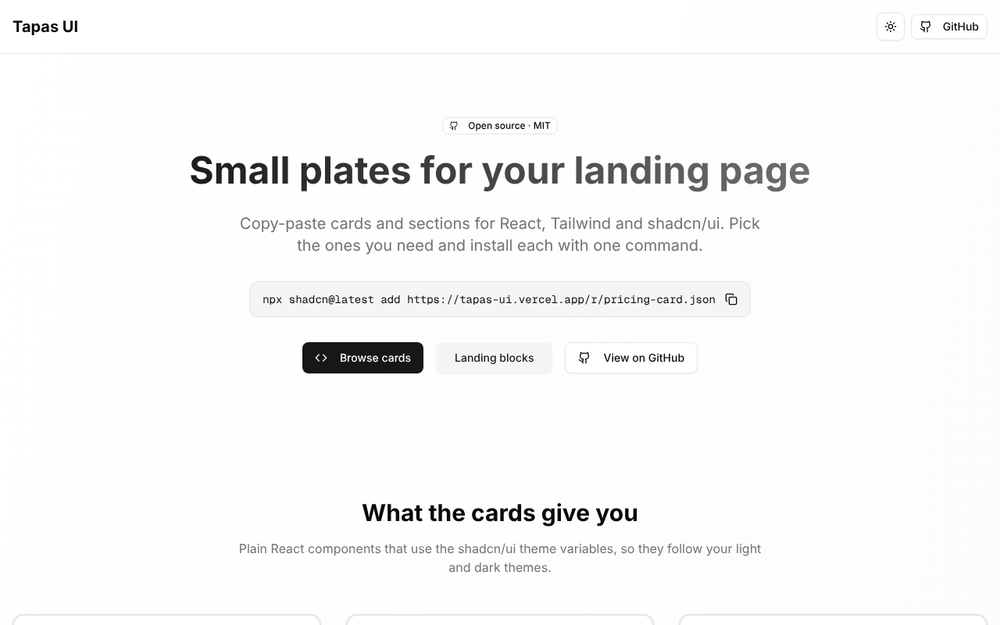
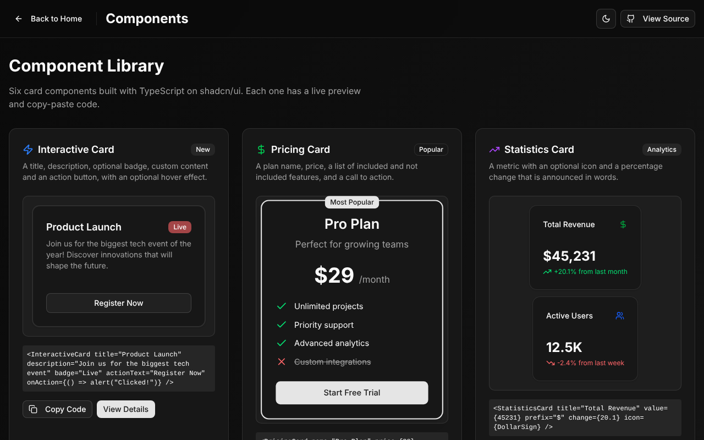
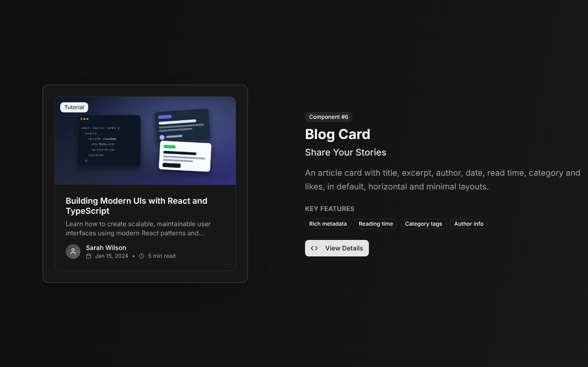

# Tapas UI

Small plates for your landing page: copy-paste cards and sections for marketing
and SaaS pages, built with React, TypeScript and Tailwind CSS on top of
[shadcn/ui](https://ui.shadcn.com/).

[](https://github.com/tahmidbintaslim/tapas-ui/actions/workflows/ci.yml)
[](LICENSE)
[](https://tapasui.tahmid.space)


**Live demo:** https://tapasui.tahmid.space

44 copy-paste sections (heroes, pricing, proof, features, navigation and
cards), most with an optional motion version, plus three free page templates.
Each one installs with the shadcn CLI and lands in your repo as code you own.



| Gallery (dark theme) | Blog card with a cover image (dark theme) |
| --- | --- |
|  |  |

## Status

- Working demo, deployed on Vercel from `main`. Not published to npm, no
  releases yet.
- To use a card, copy its folder from `src/components/custom/` into a Next.js
  app that has shadcn/ui set up, plus the primitives it imports (`card`,
  `button`, `badge`). See [Usage](#usage).
- CI runs lint, typecheck, unit tests and a production build on every push and
  pull request to `main`.
- The cards have not been tested with screen readers yet. The Playground tab
  is a placeholder on the five detail pages that have one.

## What is in the box

| Component | What it shows |
| --- | --- |
| Interactive card | Title, description, optional badge, custom content and an action button |
| Pricing card | Plan name, price, a list of included and not included features, a call to action |
| Statistics card | A metric with an optional icon and a percentage change (up, down or no change) |
| Testimonial card | A quote with author, role, company, optional avatar and a star rating |
| Feature card | An icon, title, description, optional badge and call to action, vertical or horizontal |
| Blog card | Title, excerpt, author, date, read time, category, likes and an optional cover image, in three layouts |

## Accessibility

What the cards do today. Unit tests in `src/components/custom/` check the
markup behind each point. The trend colors were measured separately: 4.95:1
(up) and 4.77:1 (down) on the light card, 10.08:1 and 6.21:1 on the dark card.

- Every card forwards `ref` and root props (`id`, `aria-*`, `data-*`, event
  handlers) to its root element. On the testimonial card, `role` is the
  author's job title, so it is not passed to the root.
- Pricing features are a real list, and each item tells screen readers whether
  it is included; the check and cross icons are hidden from them.
- The statistics trend is announced in words ("Up", "Down", "No change"), not by
  color or icon alone, and its colors meet WCAG AA contrast in both themes.
- Testimonials use `figure`, `blockquote` and `figcaption`; the stars are one
  image labeled "Rated N out of 5".
- The blog card is an `article` with a `time` element. When it has `href` or
  `onClick`, the title is its only control and the whole card is clickable;
  there is no button nested inside a link.
- Decorative icons are `aria-hidden`, and avatars and cover images next to a
  visible name or title use empty alt text.

The demo's scroll animations run only when the visitor has not asked for
reduced motion. Interactive behavior beyond that comes from the shadcn/ui and
Radix UI primitives.

## Tech stack

| Area | Choice |
| --- | --- |
| Framework | Next.js 15.5 (App Router, every page prerendered as static HTML) |
| UI | React 19, shadcn/ui primitives (new-york style), Radix UI Slot and Tabs |
| Styling | Tailwind CSS 4, `tailwind-merge`, `class-variance-authority`, `next-themes` |
| Icons and motion | lucide-react, [`motion`](https://motion.dev) (motion versions only) |
| Tests | Vitest 5, Testing Library, jsdom |
| Tooling | TypeScript 5 (strict), ESLint 9 with `eslint-config-next`, pnpm 10 |

## How it fits together

- `src/components/custom/<card>/` holds each card: the component, an
  `index.ts` export and, for most cards, a `.test.tsx` file. Cards import only
  the `card`, `button` and `badge` primitives from `src/components/ui/` and the
  `cn()` helper.
- `src/app/page.tsx` is the landing page. Its example site is built only from
  Tapas sections, and a CSS-only color picker re-themes it.
- `src/app/docs/` holds the docs: introduction, installation, theming and one
  page per section (`/docs/sections/<name>`) with a live preview, the real
  source in a Code tab, the install command, usage, props and accessibility
  notes. Previews, usage and props live in `src/app/docs/_content.tsx`.
- Each section has Storybook stories next to it
  (`src/components/custom/<name>/<name>.stories.tsx`), with light and dark
  themes and the accessibility addon. The site serves the built Storybook at
  [/storybook](https://tapasui.tahmid.space/storybook).
- Colors come from the shadcn/ui CSS variables in `src/app/globals.css`, plus
  a `--success` variable for positive states. Two defaults use fixed Tailwind
  colors that do not follow the theme: the blog card's category badge
  (`bg-gray-100 text-gray-800`, change it with `categoryColor`) and the
  testimonial card's stars (`text-yellow-400`, `text-gray-300`).

## Getting started

### Prerequisites

- Node.js 22 (22.13 or later), 24, or 26 and later (CI uses Node 22). This is
  the `engines` range in `package.json`. Vitest 5 does not run on Node 20,
  which reached end of life in April 2026, or on Node 23 and 25, and jsdom 29
  needs 22.13 or later on the 22 line.
- pnpm 10.34.6. The version is pinned in `package.json`, and
  `corepack enable` installs it for you.

### Install and run

```bash
git clone https://github.com/tahmidbintaslim/tapas-ui.git
cd tapas-ui
corepack enable
pnpm install --frozen-lockfile
pnpm dev
```

Then open the URL that `pnpm dev` prints (http://localhost:3000 by default).

No environment variables are needed, so there is no `.env.example`. To opt
out of Next.js telemetry, set `NEXT_TELEMETRY_DISABLED=1`.

### Scripts

| Command | What it does |
| --- | --- |
| `pnpm dev` | Start the development server with Turbopack |
| `pnpm storybook` | Start Storybook on port 6006 |
| `pnpm build-storybook` | Build Storybook into `public/storybook/` |
| `pnpm lint` | Run ESLint |
| `pnpm typecheck` | Run the TypeScript compiler without emitting files |
| `pnpm test` | Run the unit tests once with Vitest |
| `pnpm build` | Build the registry, Storybook and the site for production |
| `pnpm start` | Serve the production build |

CI runs `pnpm install --frozen-lockfile`, `lint`, `typecheck`, `test` and
`build`, in that order. Run the same before you open a pull request.

## Storybook

Every section has stories with light and dark themes, at
[tapasui.tahmid.space/storybook](https://tapasui.tahmid.space/storybook).

- **Design panel:** stories link to their frames in the
  [website Figma file](https://www.figma.com/design/gAmq9l9IOIKCbvxlWwGX4o)
  through `@storybook/addon-designs` (`parameters.design`).
- **Accessibility panel:** axe runs on every story and fails on violations.
- **Storybook MCP:** `pnpm storybook` also serves an MCP server at
  `http://localhost:6006/mcp` (`@storybook/addon-mcp`). It lists components,
  their docs and stories for AI agents; `.mcp.json` registers it for Claude Code.
- **Chromatic:** `.github/workflows/chromatic.yml` publishes Storybook to
  Chromatic on every push and pull request once a `CHROMATIC_PROJECT_TOKEN`
  repository secret exists, giving a hosted Storybook per branch and visual
  review. Without the secret the job skips.

## Install with the shadcn CLI

Every card is a shadcn registry item, served by the demo site. In a project
that already has shadcn/ui set up:

```bash
npx shadcn@latest add https://tapasui.tahmid.space/r/pricing-card.json
```

Items: `interactive-card`, `pricing-card`, `statistics-card`,
`testimonial-card`, `feature-card`, `blog-card`, plus the seven landing blocks listed under
[Landing blocks](#landing-blocks). The CLI also adds the `card`,
`button` and `badge` primitives each card needs. The testimonial and blog cards
use `next/image`, so they need Next.js. `pnpm build` regenerates `public/r/`
from `registry.json`.

## Heroes

Ten heroes, each in a **plain** version (CSS only, renders as a server component,
no extra packages) and a **motion** version (a client component built on
[`motion`](https://motion.dev)). Preview them at
[tapasui.tahmid.space/docs/sections](https://tapasui.tahmid.space/docs/sections).

| Hero | What it does | Plain | Motion |
| --- | --- | --- | --- |
| `hero` | Centered headline, badge and two links | `npx shadcn@latest add https://tapasui.tahmid.space/r/hero.json` | `…/r/hero-motion.json` |
| `hero-split` | Copy beside your product image or component | `npx shadcn@latest add https://tapasui.tahmid.space/r/hero-split.json` | `…/r/hero-split-motion.json` |
| `hero-command` | Built around one copyable command | `npx shadcn@latest add https://tapasui.tahmid.space/r/hero-command.json` | `…/r/hero-command-motion.json` |
| `hero-spotlight` | Grid canvas with a glow in your primary color | `npx shadcn@latest add https://tapasui.tahmid.space/r/hero-spotlight.json` | `…/r/hero-spotlight-motion.json` |
| `hero-showcase` | Headline over a framed live component | `npx shadcn@latest add https://tapasui.tahmid.space/r/hero-showcase.json` | `…/r/hero-showcase-motion.json` |
| `hero-waitlist` | Email signup that works without JavaScript | `npx shadcn@latest add https://tapasui.tahmid.space/r/hero-waitlist.json` | `…/r/hero-waitlist-motion.json` |
| `hero-marquee` | Headline over an endless logo row | `npx shadcn@latest add https://tapasui.tahmid.space/r/hero-marquee.json` | `…/r/hero-marquee-motion.json` |
| `hero-video` | Poster and video that never autoplays | `npx shadcn@latest add https://tapasui.tahmid.space/r/hero-video.json` | `…/r/hero-video-motion.json` |
| `hero-theme-cycle` | The whole hero cycles through color themes | `npx shadcn@latest add https://tapasui.tahmid.space/r/hero-theme-cycle.json` | `…/r/hero-theme-cycle-motion.json` |
| `hero-plates` | Sections stack into a page as you scroll | `npx shadcn@latest add https://tapasui.tahmid.space/r/hero-plates.json` | `…/r/hero-plates-motion.json` |

### Plain and motion

- Both versions take the same props. Installing `<name>-motion` also installs
  `<name>` and the `motion` package.
- Motion versions follow the visitor's reduced-motion setting and render the
  plain layout when it is on.
- Nothing is hidden before it animates: server HTML shows every heading, line
  and button, so the page reads fine before JavaScript loads.
- Anything that moves on its own (the marquee, the theme cycle) has a visible
  pause button and stops on hover and keyboard focus.

## Sections

44 sections: 10 heroes (above), 28 landing blocks and 6 cards. 35 of them also come in a motion version.
Each installs with `npx shadcn@latest add https://tapasui.tahmid.space/r/<name>.json`
(add `-motion` for the motion version). Live previews, props and notes are at
[tapasui.tahmid.space/docs/sections](https://tapasui.tahmid.space/docs/sections).

### Marketing

| Section | What it does | Motion |
| --- | --- | --- |
| `pricing-table` | Pricing tiers with a monthly/yearly switch that works without JavaScript. | yes |
| `comparison-table` | Feature-by-plan table with row headers that scrolls inside its own box on phones. | plain only |
| `cta-banner` | Full-width call-to-action band with a heading, text and one button. | yes |
| `cta-split` | Call-to-action band with your product image or component beside the copy. | yes |
| `newsletter` | Newsletter signup band; a plain HTML form that works without JavaScript. | yes |

### Proof

| Section | What it does | Motion |
| --- | --- | --- |
| `logo-cloud` | A 'trusted by' strip of logos or company names. | yes |
| `testimonials-wall` | A masonry wall of short testimonials. | yes |
| `testimonial-highlight` | One large, centered quote for a single strong testimonial. | yes |
| `stats-band` | A band of big numbers with labels. | yes |
| `social-proof` | Avatar stack, optional star rating and one line of text. | yes |

### Features

| Section | What it does | Motion |
| --- | --- | --- |
| `feature-grid` | A grid of features with icons, in 2 to 4 columns. | yes |
| `feature-rows` | Feature rows with media on alternating sides. | yes |
| `bento-grid` | Feature grid with tiles of mixed sizes that stack on phones. | yes |
| `steps` | Numbered how-it-works steps as an ordered list. | yes |
| `integrations-grid` | A grid of integrations or tools, each optionally linking to its page. | yes |

### Company

| Section | What it does | Motion |
| --- | --- | --- |
| `team` | The people behind the product: photo or initials, role, bio and links. | plain only |
| `blog-grid` | A grid of recent posts built from the blog card, with a view-all link. | yes |
| `changelog` | Dated release notes with versions, newest first. | plain only |
| `faq` | Accordion-style FAQ built on native details and summary. | yes |
| `faq-two-column` | FAQ with an intro column and contact link beside the questions. | plain only |
| `contact` | Contact form beside your contact details; works without JavaScript. | plain only |

### Navigation & utility

| Section | What it does | Motion |
| --- | --- | --- |
| `navbar` | Top navigation with a brand, links and an action; links fold into a no-JS menu on phones. | yes |
| `navbar-floating` | A pill-shaped navbar floating over the page; links fold into a no-JS menu on phones. | yes |
| `announcement-bar` | A slim, optionally dismissible bar above the navbar for one announcement. | plain only |
| `footer` | Site footer with a brand name, link columns and a small-print line. | plain only |
| `footer-simple` | A one-row footer with brand, a few links and small print. | plain only |
| `not-found` | A friendly 404 section with a link home and optional helpful links. | yes |
| `coming-soon` | Pre-launch section: what's coming, the launch date if known, and a notify form. | plain only |

### Cards

| Card | What it does | Motion |
| --- | --- | --- |
| `interactive-card` | Title, description, optional badge, custom content and an action button. | yes |
| `pricing-card` | Plan name, price, included and excluded features, and a call to action. | yes |
| `statistics-card` | A metric with an optional icon and an up, down or flat percentage change. | yes |
| `testimonial-card` | A quote with author, role, company, optional avatar and a star rating. Uses next/image. | yes |
| `feature-card` | An icon, title, description, optional badge and call to action, vertical or horizontal. | yes |
| `blog-card` | Title, excerpt, author, date, read time, category and cover image in three layouts. Uses next/image. | yes |

```tsx
import { Faq } from "@/components/custom/faq";

<Faq items={[{ question: "Is there a free plan?", answer: "Yes, for one project." }]} />;
```

Plain sections render from server components. All of them follow your shadcn
theme, so they work in light and dark mode.

## Templates

Three free page templates built only from Tapas sections, each in a plain and
a motion version. Browse them at
[tapasui.tahmid.space/templates](https://tapasui.tahmid.space/templates).

| Template | Page | Plain | Motion |
| --- | --- | --- | --- |
| SaaS landing page | Split hero, logos, features, stats, testimonials, pricing, FAQ, CTA | `npx shadcn@latest add https://tapasui.tahmid.space/r/template-saas.json` | `…/r/template-saas-motion.json` |
| Waitlist page | Floating navbar, waitlist hero, social proof, feature rows, FAQ | `npx shadcn@latest add https://tapasui.tahmid.space/r/template-waitlist.json` | `…/r/template-waitlist-motion.json` |
| AI product page | Announcement bar, spotlight hero, steps, integrations, comparison, pricing | `npx shadcn@latest add https://tapasui.tahmid.space/r/template-ai.json` | `…/r/template-ai-motion.json` |

A template installs into `components/templates/<name>/` along with every
section it uses. Pass your copy through one `content` prop; anything you leave
out keeps the sample text, which is fictional and labelled as such:

```tsx
import { SaasTemplate } from "@/components/templates/saas/saas";

export default function Page() {
  return <SaasTemplate content={{ brand: { name: "Your product" }, hero: { title: "Your headline" } }} />;
}
```

## Usage

### Interactive card

```tsx
import { InteractiveCard } from "@/components/custom/interactive-card";

<InteractiveCard
  title="Product launch"
  description="Join us for the launch event."
  badge="Live"
  badgeVariant="destructive"
  hoverEffect={true}
  actionText="Register now"
  onAction={() => alert("Registration clicked!")}
/>;
```

### Pricing card

```tsx
import { PricingCard } from "@/components/custom/pricing-card";

<PricingCard
  name="Pro Plan"
  description="For growing teams"
  price={29}
  currency="$"
  period="month"
  features={[
    { text: "Unlimited projects", included: true },
    { text: "Priority support", included: true },
    { text: "Advanced analytics", included: true },
    { text: "Custom integrations", included: false },
  ]}
  ctaText="Start free trial"
  popular={true}
  onSelect={() => alert("Plan selected!")}
/>;
```

### Statistics card

```tsx
import { StatisticsCard } from "@/components/custom/statistics-card";
import { DollarSign } from "lucide-react";

<StatisticsCard
  title="Total revenue"
  value={45231}
  prefix="$"
  change={20.1}
  changePeriod="from last month"
  icon={DollarSign}
/>;
```

### Testimonial card

```tsx
import { TestimonialCard } from "@/components/custom/testimonial-card";

<TestimonialCard
  testimonial="Your customer's quote goes here."
  author="Alex Chen"
  role="Frontend developer"
  company="Example Inc"
  rating={5}
  avatar="/avatars/alex.webp"
  variant="elevated"
/>;
```

### Feature card

```tsx
import { FeatureCard } from "@/components/custom/feature-card";
import { BarChart3 } from "lucide-react";

<FeatureCard
  title="Advanced analytics"
  description="See how each page performs."
  icon={BarChart3}
  badge="Popular"
  ctaText="Explore analytics"
  onCtaClick={() => alert("Analytics clicked!")}
  hoverEffect={true}
/>;
```

### Blog card

```tsx
import { BlogCard } from "@/components/custom/blog-card";

<BlogCard
  title="Building modern UI components"
  excerpt="How to build reusable UI components with TypeScript."
  author="Sarah Wilson"
  date="2024-01-15"
  readTime="8 min read"
  category="React"
  likes={127}
  image="/blog/building-modern-ui-components.webp"
  href="/blog/building-modern-ui-components"
/>;
```

The names, quotes and numbers in these examples and in the demo are sample
content. The demo's avatar and blog cover are small WebP files in
`public/demo/`, drawn for this project.

### Customization

Each card accepts a `className` that is merged onto its root element with
`tailwind-merge`, so your classes win over the defaults:

```tsx
<InteractiveCard
  title="Custom styled card"
  description="This card has custom styling"
  className="bg-primary text-primary-foreground border-0"
/>
```

The blog card is the exception: its root is an `<article>` that wraps the
card, so `className` there sets layout (width, margin, grid placement) and does
not restyle the card surface. Use `variant` for that, or edit the copied file.

The pricing and statistics cards use the `--success` color. When you copy
them, also copy `--success` from the `:root` and `.dark` blocks and
`--color-success` from the `@theme inline` block in `src/app/globals.css`.
Light and dark themes are switched with `next-themes`.

### Known limitations

- `BlogCard` and `TestimonialCard` render images with `next/image`, so they need
  Next.js. Images must be files in `public/` or URLs allowed in
  `images.remotePatterns` in `next.config.ts`.
- `PricingCard`, `FeatureCard`, `InteractiveCard` and `BlogCard` import the
  `button` or `badge` primitive, which uses `@radix-ui/react-slot`. That
  package creates a React context when it loads, so these cards crash in an
  App Router Server Component. Render them from a Client Component (a file
  that starts with `"use client"`).
- The Playground tab is a placeholder on the five detail pages that have one.

## Deployment

The demo is deployed on Vercel (project `tapas-ui`) through Vercel's
GitHub integration: pushes to `main` update https://tapasui.tahmid.space
and each pull request gets a preview URL (it needs a Vercel login with access
to the project). Vercel detects Next.js and runs
`pnpm install` and `pnpm build`; no environment variables are set.

To run the production build anywhere else:

```bash
pnpm build
pnpm start
```

## Project structure

```
.
├── .github/
│   ├── workflows/ci.yml     # Lint, typecheck, test, build
│   └── dependabot.yml       # Weekly grouped dependency updates
├── .storybook/              # Storybook config (Next.js, a11y, themes)
├── docs/images/             # README screenshots
├── public/demo/             # Sample avatar and blog cover used by the demo
├── src/
│   ├── app/
│   │   ├── _landing/        # Landing page parts (theme showcase, sketches)
│   │   ├── _site/           # Header, footer, links, section list
│   │   ├── docs/            # Docs pages and per-section content
│   │   ├── globals.css      # Theme variables and Tailwind setup
│   │   ├── layout.tsx       # Root layout and metadata
│   │   └── page.tsx         # Landing page
│   ├── components/
│   │   ├── custom/          # Sections and cards, with tests and stories
│   │   └── ui/              # shadcn/ui primitives and the theme toggle
│   └── lib/utils.ts         # cn() class name helper
└── vitest.config.mts        # Test setup (jsdom, "@/" alias)
```

## Roadmap

- Test the cards with VoiceOver and NVDA and record the results here.

## Contributing

If Tapas UI saves you time, a star on GitHub helps other people find it. Want to help? See the [good first issues](https://github.com/tahmidbintaslim/tapas-ui/labels/good%20first%20issue) and [help wanted](https://github.com/tahmidbintaslim/tapas-ui/labels/help%20wanted).

Issues and pull requests are welcome. See [CONTRIBUTING.md](CONTRIBUTING.md).

## License

MIT, see [LICENSE](LICENSE). The shadcn/ui code in this repository is also MIT
licensed; see [THIRD_PARTY_NOTICES.md](THIRD_PARTY_NOTICES.md).

## Acknowledgments

- [shadcn/ui](https://ui.shadcn.com/) for the primitives and theme variables
  these cards are built on
- [Radix UI](https://www.radix-ui.com/) for accessible primitives
- [Tailwind CSS](https://tailwindcss.com/) for styling
- [Lucide](https://lucide.dev/) for icons
- [Next.js](https://nextjs.org/) for the framework
